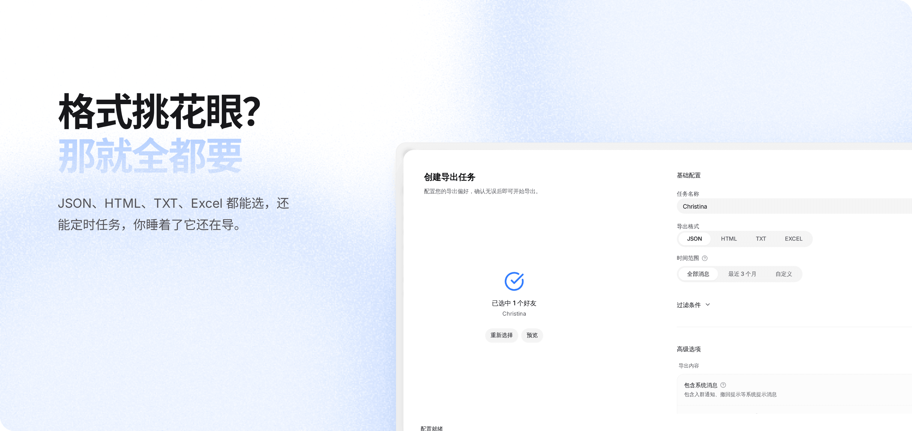
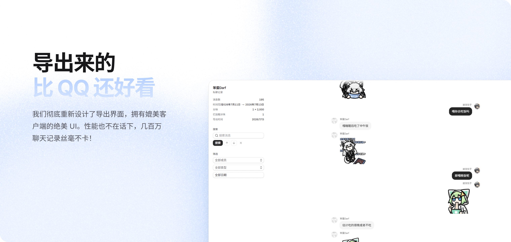
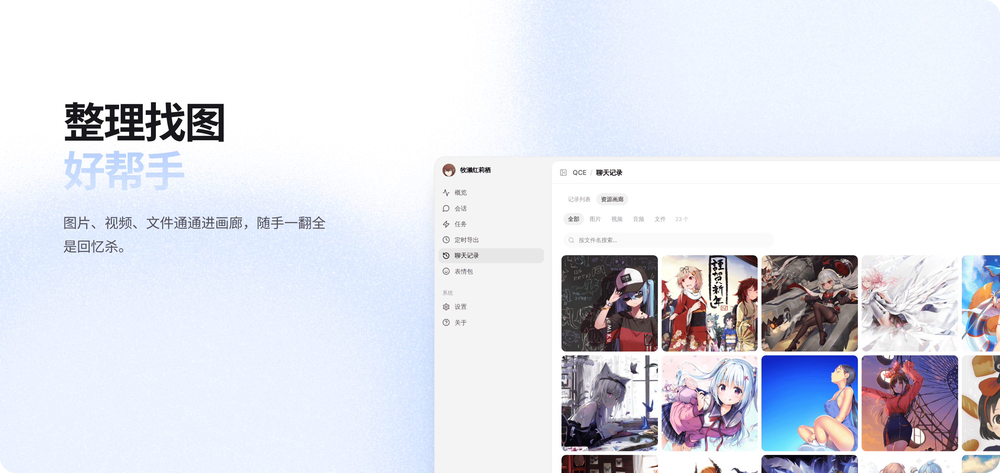
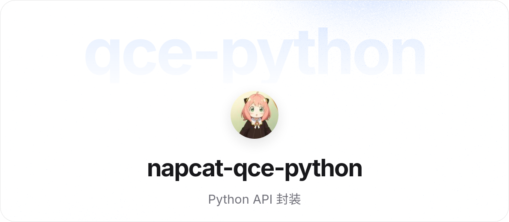

[![][image-banner]][releases-link]

# QQ Chat Exporter — v6 补丁版

> [!IMPORTANT]
>
> 这是 [shuakami/qq-chat-exporter](https://github.com/shuakami/qq-chat-exporter) 的 **v6 补丁版**。
> 上游原版功能与文档完全保留，本页额外说明补丁内容。

在官方原版之上叠加 5 项改进：媒体文件本地缓存回填、好友列表缓存、`qqDataRoots` 配置优先、bridge 连接容错，以及更明确的错误提示。

所有读取与解析仍**完全在本机完成**，不新增任何网络请求、不上传任何数据。

**[使用文档][docs-link]** **[上游仓库][upstream-link]** **[反馈问题][issues-link]**

[![][github-release-shield]][upstream-link]
[![][github-license-shield]][license-link]

> [!TIP]
>
> 你的改动已推送到个人 Fork：<https://github.com/yd633/qq-chat-exporter>

---

## 补丁内容

| 模块 | 改进 | 环境变量 |
| :-- | :-- | :-- |
| 媒体回填 | 按 md5 在 `Video` / `Ptt` / `Pic` / `File` 四类目录中定位资源，避免导出时因路径失效丢文件 | — |
| 好友列表 | 300 秒内存缓存，避免每次打开面板都回源 | `QCE_FRIENDS_CACHE_SECS`（`0` 禁用） |
| 好友列表 | 可恒定返回空列表 | `QCE_FRIENDS_DISABLED` |
| 路径配置 | `qqDataRoots` 有值时直接采用，仅在为空时才全盘探测 | `QCE_QQ_AUTO_DETECT=1` 恢复旧的并集行为 |
| bridge 容错 | 调用前先探活；遇传输错误自动重试 | `QCE_BRIDGE_READY_ATTEMPTS`（默认 20）<br>`QCE_BRIDGE_READY_INTERVAL_MS`（默认 500）<br>`QCE_BRIDGE_CALL_RETRIES`（默认 2） |
| 错误提示 | bridge 故障返回 503 + 可操作文案 | — |

改动规模：**+986 / -19**，10 个文件（相对上游 `7d154b8`）。

### 错误提示的改动

补丁前：

```
bridge 传输错误: error sending request for url (http://127.0.0.1:40654/rpc)
```

补丁后：

```
无法获取好友列表：NapCat 尚未就绪。QQ 正在启动或刚刚重启，
请等待几秒后重试（QQ 完全退出时需重新登录并启动 QQ）
```

HTTP 状态码同时从 500 改为 **503**，便于前端区分「暂时不可用」与「真出错了」。

### 加载好友时的进度条

打开导出面板时，页面顶部会显示百分比进度、当前页数与剩余时间。

```
正在从 QQ 读取好友数据…（已用 12 秒）      ← 总量未知，只报已用
正在加载好友 5 / 12 页  剩余 1 秒        ← 已拿到总页数，切为真实进度
好友列表加载完成                            ← 0.9 秒后自动收起
```

第一页返回前无法得知总量，此时显示脉冲条而非百分比 —— 不用编造的进度误导你。

---

## 特性








## 快速开始

### Windows 一键安装（推荐）

下载 [Release](https://github.com/yd633/qq-chat-exporter/releases) 中的完整包，解压后运行 `launcher-user.bat`。

> [!NOTE]
>
> 请先在浏览器登录 QQ，再运行启动器。启动后在控制台查看访问令牌，
> 打开 <http://localhost:40653/qce> 并填入。

### 已有 QQ 的情况

补丁版直接替换安装目录下的 `qce-server.exe` 即可，无需重装 QQ 或重新登录。

> [!WARNING]
>
> **不要直接双击 `QQ Chat Exporter.exe`** —— 它是完整包入口，每次运行都会把
> 官方文件重新解压覆盖，你的补丁会被冲掉。日常启动请用 `launcher-user.bat`。

### Shell 模式（Windows / Linux / macOS）

```bash
./launcher-user.sh
```

> [!NOTE]
>
> macOS 当前仅提供 Apple Silicon（arm64）预览包，且启动前需要完全退出电脑上的 QQ，详见 [macOS 使用指南][macos-doc]。

### Docker 一键部署

```bash
docker run -d --name qce \
  -p 40653:40653 \
  -v "$(pwd)/data:/app/data" \
  yd633/qq-chat-exporter
```

```bash
# 查看登录二维码与 Token
docker logs -f qce
```

> [!NOTE]
>
> Apple Silicon (M1/M2/M3/M4) 通过 Rosetta 模拟运行，首次启动可能稍慢。详见 [Docker 部署指南][docker-doc]。

## 文档

- [使用指南][docs-link]
- [反馈问题][issues-link]

## 已知问题

**首次加载好友列表可能较慢。** 本补丁 v6 的就绪探测走 `GET /healthz`（实测约 2 ms 返回，
仅反映端口是否在监听），而真实 `POST /rpc` 需约 900 ms。NapCat 启动时先监听端口、
再初始化业务处理器，该窗口内探活会假通过并触发重试空转。

如果你在冷启动后立刻点「加载好友」感觉卡顿，这是原因之一，属已知行为。
后续版本已改用真实 RPC 探测。

## 相关项目

[](https://chatlab.fun/cn)

<p><a href="https://github.com/Ruoan-486/QCE2Chatlab"></a><a href="https://github.com/CutrelyAlex/QQChatAnalyzer"></a><a href="https://github.com/JUSTMONIKA2022/QQ-Chat-AI-Analyzer"></a><a href="https://github.com/streetartist/napcat-qce-python"></a></p>

我们非常欢迎和 QCE 有关的社区项目！如果需要展示您的项目，可以在[这里](https://github.com/shuakami/qq-chat-exporter/issues/new)提一个 issue。

## 致谢

- 上游作者与维护者：[shuakami/qq-chat-exporter](https://github.com/shuakami/qq-chat-exporter)
- 框架支持：[NapCatQQ](https://github.com/NapNeko/NapCatQQ) 团队
- 参与开发？请阅读[贡献指南](https://shuakami.github.io/qq-chat-exporter/docs/contributing.html)

<a href="https://github.com/shuakami/qq-chat-exporter/graphs/contributors">
  
</a>

## 许可证

沿用上游项目的许可证，详见 [LICENSE](https://github.com/shuakami/qq-chat-exporter/blob/main/LICENSE)。

<!-- 链接定义：沿用上游 README 的引用式写法与配色 -->
[image-banner]: docs/images/banner.png
[upstream-link]: https://github.com/shuakami/qq-chat-exporter
[docs-link]: https://shuakami.github.io/qq-chat-exporter/
[releases-link]: https://github.com/yd633/qq-chat-exporter/releases
[issues-link]: https://github.com/yd633/qq-chat-exporter/issues
[license-link]: LICENSE
[docker-doc]: https://shuakami.github.io/qq-chat-exporter/docs/docker-napcat-deployment.html
[macos-doc]: https://shuakami.github.io/qq-chat-exporter/docs/macos-deploy.html
[github-release-shield]: https://img.shields.io/github/v/release/shuakami/qq-chat-exporter?color=317cfe&labelColor=black&logo=github&style=flat-square
[github-license-shield]: https://img.shields.io/badge/license-GPL--3.0-317cfe?labelColor=black&style=flat-square
